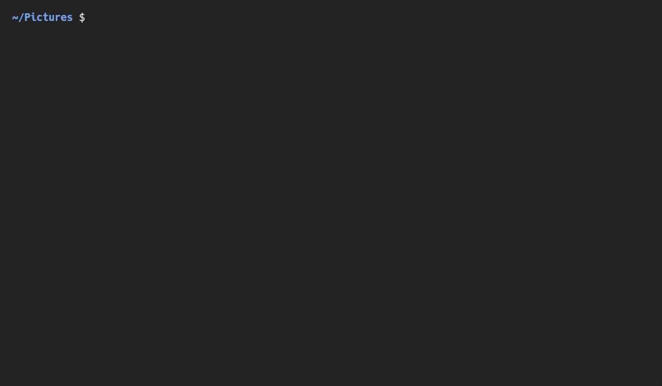

# scry

grep for images. Find images by what they show, the text in them, or their metadata.

[](https://github.com/JirkaKlimes/scry/actions/workflows/ci.yml)
[](https://crates.io/crates/scry-cli)
[](https://buymeacoffee.com/jiriklimes)



```sh
scry -q "a dog playing in the snow" ~/Pictures   # what the image shows, best match first
scry -t 'INV-\d{4}' ~/Documents                  # text in the image
scry --date 2024-06..2024-08 --gps ~/Pictures    # metadata
scry --grid -q "foggy forest" ~/Pictures         # pick by eye
```

scry prints paths for pipelines, or JSON Lines for other programs. After a one-time model download it works offline. It runs on your CPU, and uses a fast GPU if it finds one.

## Install

Linux and macOS, on x86_64 and aarch64.

```sh
curl --proto '=https' --tlsv1.2 -LsSf https://github.com/JirkaKlimes/scry/releases/latest/download/scry-cli-installer.sh | sh
cargo binstall scry-cli
cargo install --locked scry-cli   # Rust 1.94 or newer
nix run github:JirkaKlimes/scry -- -q "a red bicycle" ~/Pictures
```

The prebuilt Linux binaries need glibc 2.35 or newer (Ubuntu 22.04, Debian 12). On other systems, use `cargo install`. The crate is `scry-cli`, because `scry` is taken on crates.io.

The first `-q` search downloads the SigLIP 2 model (about 500 MB), and `-l` needs only its image part (about 190 MB). The first `-t` or `-o` search downloads the OCR models (about 12 MB). scry checks each model against a pinned SHA-256 hash and keeps it in the cache directory: `$SCRY_CACHE`, else `$XDG_CACHE_HOME/scry` or `~/.cache/scry` on Linux, and `~/Library/Caches/scry` on macOS.

## Examples

```sh
# A query in any language, and bears that are not teddy bears
scry -q "kočky na gauči" ~/Pictures
scry -q bear -x "teddy bear" ~/Pictures

# Images that look like this one
scry -l IMG_2041.jpg ~/Pictures

# Summer 2024, a Fujifilm camera, 4000 px wide or more
scry --date 2024-06..2024-08 --camera fuji --width 4000.. ~/Pictures

# PNG images from the last 7 days, and the newest screenshot that shows an error
scry -g '*.png' --date 7d ~
scry --sort date -n 1 -t error ~/Pictures/Screenshots

# Photos from one afternoon, and screenshots from the last 30 minutes
scry --date 2024-06-15T13..2024-06-15T18 ~/Pictures
scry --date 30m ~/Pictures/Screenshots

# The text that scry reads, and each invoice number with its file
scry -o screenshot.png
scry -o -t 'INV-\d{4}' ~/scans

# The 50 best receipts, newest first
scry -q "a receipt" -n 50 --sort date ~/Documents

# Each new screenshot that shows an error, as it comes
scry --watch=new -t error ~/Pictures/Screenshots

# Move each new receipt out of Downloads
scry --watch=new -0 -q "a receipt" --min 0.02 ~/Downloads | xargs -0 -I{} mv {} ~/Receipts/

# Pick images by eye and open them (on macOS, use open)
scry -s -0 -q "a receipt" ~/Downloads | xargs -0 -r -n1 xdg-open

# NUL-separated paths from another tool
fd -0 -e jpg . ~/Pictures | scry -0 -t invoice | xargs -0 -I{} cp {} ~/invoices
```

`scry --help` shows all options.

`--watch` searches the directories as usual, then keeps watching them and searches each new image the same way. `--watch=new` shows only the new images. An image that changes after the start also counts as new. With `-q` or `-l` it needs `--min`: a new image goes out when its score is high enough.

## Pick by eye

Scatter mode (`-s`) shows the images one at a time, each at a new place on the screen, so your eye checks only the newest one. Grid mode (`--grid`) shows pages of up to 26 thumbnails to compare side by side. Like fzf, both modes draw on the terminal and write only the result to stdout.

| Key | Action |
|---|---|
| `a` to `z` | Select the image with that hint letter. In scatter mode, pause first. |
| `A` to `Z` | Show that image full screen. `←` and `→` go through the images. |
| `Tab` | Mark or unmark the selected image. |
| `Enter` | Print the marked images, or else the selected image, and quit. In scatter mode with neither, pause and select the best image in view. |
| `/` | Rank the images by a text as you type it. `Enter` keeps the ranking, `Esc` goes back. |
| `*` | Rank the images by how similar they look to the selected image. |
| `Backspace` | Go back one ranking. |
| `Esc`, `Ctrl-C` | Quit and print nothing. |
| Scatter mode | `Space` pauses and plays, `←` and `→` step through the images, `+` and `-` change the speed, `]` and `[` the size. |
| Grid mode | `←`, `→`, `Space`, `PageUp` and `PageDown` change the page. |

A ranking changes only the order: options like `-t`, `--date` and `--min` still choose the images. Marks stay, so you can mark images from many queries and print them all at once. Without `-q` or `-l`, the first `/` or `*` embeds the images in the background.

`--bind KEY:COMMAND` runs a command on the marked images, or else on the selected image. KEY is `ctrl-a` to `ctrl-z` (except `ctrl-c`, `ctrl-h`, `ctrl-i`, `ctrl-j` and `ctrl-m`), `alt-a` to `alt-z`, or `f1` to `f12`. The paths go to `sh` as arguments (`"$1"`, `"$@"`), so no file name can inject code. The command runs in the background, and the status line tells you when it ends.

```sh
# Copy the images to a folder, or move them to the trash (gio is a Linux tool)
scry --grid --bind 'ctrl-d:cp -- "$@" ~/picked/' --bind 'ctrl-x:gio trash -- "$@"' ~/Pictures

# Copy the selected image, to paste it in a chat (wl-copy is for Linux with Wayland)
scry --grid -q "a diagram" --bind 'ctrl-y:wl-copy < "$1"' ~/Documents
```

With `--watch`, a new image lands on the pile next in scatter mode, and at its place in the order in grid mode.

kitty, Ghostty, iTerm2, WezTerm, foot and other terminals with sixel support show full-resolution images, also in tmux. Other terminals get Unicode half blocks.

## Use from other programs

`--json` prints JSON Lines on stdout, one object per line, so a launcher or a script can show progress and results as they come. Give the paths, or `-` to read a list of paths on stdin.

| `type` | Fields |
|---|---|
| `download` | `label`, `done`, `total` in bytes, while a model downloads |
| `progress` | `stage` (`load`, `check`, `score`, `text`, `watch`), `done`, `total`, `walking` |
| `match` | `path`, `score` with `-q` or `-l`, `date`, `taken`, `modified`, `width`, `height`, `camera`, `gps`, `matches` with `-t`, `text` with `-o` |
| `warning` | `code` (`unreadable`, `unsupported`, `no_images`, `gpu_fallback`, `no_cache`, `unwatched`), `message`, `path` for a file |
| `end` | `matched`, `truncated`, `found`, `unsupported`, `unreadable` |
| `error` | `code` (`usage`, `download`, `other`), `message` |

```sh
scry --json -n 1 -q "a red car" ~/Pictures
{"type":"progress","stage":"load","done":0,"total":1311,"walking":true}
{"type":"progress","stage":"score","done":1311,"total":1311,"walking":false}
{"type":"match","path":"/home/me/Pictures/IMG_2041.jpg","score":0.0412,"date":"2024-06-15T14:30:05","taken":"2024-06-15T14:30:05","modified":"2024-06-16T08:12:44Z","width":4000,"height":3000,"camera":"FUJIFILM X-T4","gps":true}
{"type":"end","matched":1,"truncated":true,"found":1311,"unsupported":0,"unreadable":0}
```

Each run ends with one `end` or one `error` line, unless a signal stops it, and the `end` line closes the progress. A `--watch` run ends only when it is stopped or reaches `-n`. Its first `progress` line with stage `watch` tells that the first pass is done. Download lines come during the `load` stage. Matches come in their final order. Split the output at `\n` only: a file name can hold other line breaks. `date` is the date that `--date` and `--sort date` use: `taken` from EXIF, else the time the file changed. `taken` and `date` are local time. `modified` is UTC. A path that is not UTF-8 also comes as base64 in `path_bytes`. The exit status is 0 when the run ends, also with no match, and 2 on an error. New fields, types and codes can come in later versions, so ignore the ones you do not know. To pass a query that starts with `-`, write `--query=TEXT`.

## How it works

scry runs the fast filters first, and the slow ones only on the images that are left: paths, then the image header and EXIF, then [SigLIP 2](https://huggingface.co/google/siglip2-base-patch16-224) embeddings, then OCR. It compares the query with each image directly, with no vector database, so the result is exact and works with all filters. The cache keeps the embeddings, text and metadata of each file until the file changes.

The first search over a folder is slow: an 8-core laptop CPU (Ryzen 9 8945HS) embeds or reads the text of about 8 to 10 images per second. Later searches process only new or changed images, and take well under a second. A new `-q` text adds about a second, to load the text model.

To embed 16 or more new images, scry uses a discrete GPU or the GPU of Apple silicon: Vulkan on Linux, Metal on macOS. On a laptop with an RTX 3070, this halves the time of a first `-q` search. Integrated GPUs on Linux and Intel Macs are often slower than the CPU, so scry uses them only with `SCRY_DEVICE=gpu`. `SCRY_DEVICE=cpu` turns the GPU off. Before scry uses a GPU, it checks that the GPU gives the same embeddings as the CPU.

scry needs no Python, no ONNX Runtime, and no CUDA or other driver SDK.

## Scores

`-q` gives the probability (0 to 1) that the text describes the image. It does not depend on the other images, so a `--min` value means the same in every folder. A correct image for an English description usually scores above 0.01, and an unrelated image below 0.0001. Queries in other languages score lower. To choose `--min`, run a search with `-S` once and look at the scores. `-l` gives the cosine similarity, from -1 to 1.

## FAQ

**Which formats does scry read?**
JPEG, PNG, GIF, WebP, BMP and TIFF. On macOS also HEIC, AVIF and JPEG XL. Not camera RAW yet. scry tells you at the end how many files it skipped.

**Why does `-t` not find a text that I can see?**
OCR can read words in an unexpected order, or read a letter wrong. Use `-o` to see what scry reads. OCR reads only Latin script for now.

**Why are some images missing?**
scry skips hidden files, the paths in `.gitignore`, and the Photos library of macOS. Use `--hidden` and `--no-ignore`, or give the path of the library.

**How do I clear the cache, or use scry without internet?**
Delete the `cache-v*.redb` files in the cache directory. For a computer without internet, copy the `models` directory from the cache directory of another computer.

## Credits

SigLIP 2 is by Google, under Apache 2.0, and the ONNX export is from [onnx-community](https://huggingface.co/onnx-community/siglip2-base-patch16-224-ONNX). The OCR models and the CPU runtime are Robert Knight's [ocrs](https://github.com/robertknight/ocrs) and [rten](https://github.com/robertknight/rten). The GPU runs on [tract](https://github.com/sonos/tract) by Sonos and on [wgpu](https://github.com/gfx-rs/wgpu). [ratatui-image](https://github.com/benjajaja/ratatui-image) draws the images in the terminal. The photos in the demo are from [Unsplash](https://unsplash.com), through [Lorem Picsum](https://picsum.photos).

If scry saves you time, you can [buy me a coffee](https://buymeacoffee.com/jiriklimes).

## License

Licensed under either of [Apache License 2.0](LICENSE-APACHE) or [MIT license](LICENSE-MIT), at your option.

Unless you explicitly state otherwise, any contribution intentionally submitted for inclusion in this project by you, as defined in the Apache-2.0 license, shall be dual licensed as above, without any additional terms or conditions.
