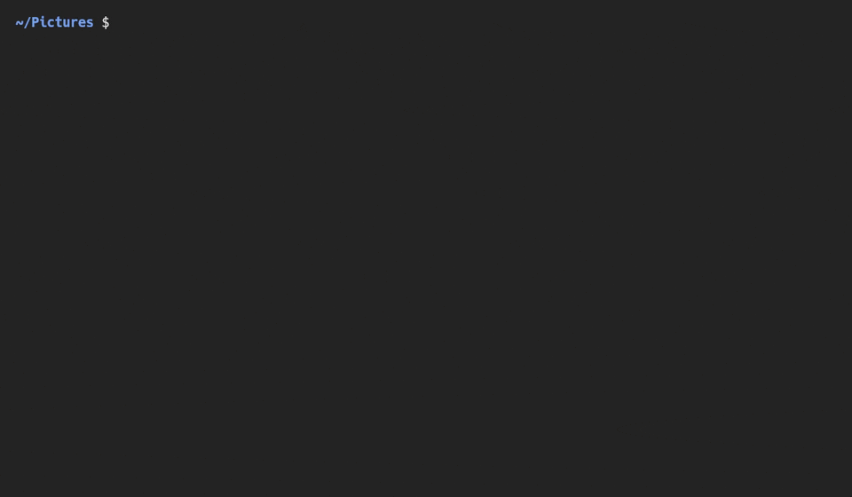

# scry

grep for images. Find images by what they show, the text in them, or their metadata.

[](https://github.com/JirkaKlimes/scry/actions/workflows/ci.yml)
[](https://crates.io/crates/scry-cli)
[](https://buymeacoffee.com/jiriklimes)



```sh
scry -q "a dog playing in the snow" ~/Pictures
scry -t 'INV-\d{4}' ~/Documents
scry --date 2024-06..2024-08 --gps ~/Pictures
scry -s -q "foggy forest" ~/Pictures
```

The first command ranks images by what they show, best first. The second finds text in images. The third keeps the photos from summer 2024 that have a GPS location. The fourth shows the matches in scatter mode, where you [pick one by eye](#pick-by-eye).

scry prints paths, so it works in pipelines. It runs on your CPU, and after a one-time model download it works offline.

## Install

Linux only for now (x86_64 and aarch64).

```sh
# Static binary, installed to ~/.local/bin
curl --proto '=https' --tlsv1.2 -LsSf https://github.com/JirkaKlimes/scry/releases/latest/download/scry-cli-installer.sh | sh

# With cargo-binstall
cargo binstall scry-cli

# From source (Rust 1.94 or newer)
cargo install --locked scry-cli

# With Nix
nix run github:JirkaKlimes/scry -- -q "a red bicycle" ~/Pictures
```

The crate is `scry-cli`, because `scry` is taken on crates.io. The binary is `scry`.

The first `-q` search downloads the SigLIP 2 model (about 500 MB), and `-l` needs only its image part (about 190 MB). The first `-t` or `-o` search downloads the OCR models (about 12 MB). scry checks each model against a pinned SHA-256 hash and keeps it in `~/.cache/scry`, or in `$SCRY_CACHE`.

## Examples

```sh
# A query in any language
scry -q "kočky na gauči" ~/Pictures

# Bears, but not teddy bears
scry -q bear -x "teddy bear" ~/Pictures

# Images that look like this one
scry -l IMG_2041.jpg ~/Pictures

# Summer 2024, a Fujifilm camera, 4000 px wide or more
scry --date 2024-06..2024-08 --camera fuji --width 4000.. ~/Pictures

# PNG images from the last 7 days
scry -g '*.png' --date 7d.. ~

# The newest screenshot that shows an error
scry --order newest -n 1 -t error ~/Pictures/Screenshots

# The text that scry reads in an image, and each invoice number with its file
scry -o screenshot.png
scry -o -t 'INV-\d{4}' ~/scans

# The receipts, newest first: choose by meaning, then sort by date
scry -q "a receipt" --min 0.01 ~/Documents | scry --order newest

# Pick images by eye and open them
scry -s -0 -q "a receipt" ~/Downloads | xargs -0 -r -n1 xdg-open

# Read NUL-separated paths from another tool
fd -0 -e jpg . ~/Pictures | scry -0 -t invoice | xargs -0 cp -t ~/invoices
```

## Options

```
scry [OPTIONS] [PATH]...
```

Each `PATH` is a file or a directory. With no `PATH`, scry reads image paths from stdin, one per line, if stdin is a pipe or a file. Otherwise it searches the current directory. An image must pass all the options that you give.

| Option | |
|---|---|
| **Meaning** | |
| `-q, --query <TEXT>` | Rank images by how well TEXT describes them, in any language. |
| `-l, --like <IMAGE>` | Rank images by how similar they look to IMAGE. IMAGE itself is not in the output. |
| `-x, --not <TEXT>` | Drop images that are closer to TEXT than to the query. Repeatable. Needs `-q`. |
| `--min <SCORE>` | Drop images that score below SCORE. Needs `-q` or `-l`. See [scores](#scores). |
| **Text in images** | |
| `-t, --text <REGEX>` | Keep images whose text matches REGEX. Repeatable: all must match. |
| `-i, --ignore-case` | Ignore case in REGEX. Without `-i`, a REGEX ignores case only if it has no capital letter. |
| `-o, --show-text` | Print the text after each path and a tab. With `-t`, print only the parts that match, separated by tabs. |
| **Metadata** | |
| `--width`, `--height <RANGE>` | Image size in pixels. |
| `--date <RANGE>` | The date the photo was taken (EXIF). For an image without one, such as a screenshot, the time the file changed. |
| `--camera <REGEX>` | Camera make and model, for example `'fujifilm x-t4'`. Ignores case. |
| `--gps`, `--no-gps` | Only images with, or without, a GPS location. |
| **Files** | |
| `-g, --glob <GLOB>` | Include paths that match GLOB, or exclude them with a leading `!`. A GLOB with a `/` matches the path below each `PATH`. Ignores case. Repeatable. Also filters paths from stdin. |
| `--hidden` | Search hidden files and directories. |
| `--no-ignore` | Do not read `.gitignore` and `.ignore` files. |
| **Output** | |
| `-s, --scatter` | Pick images by eye, one at a time. See [scatter mode](#scatter-mode). |
| `--grid` | Pick images by eye from pages of thumbnails. Not with `-s`. See [grid mode](#grid-mode). |
| `--order <ORDER>` | Sort by `--date`: `newest` or `oldest` first. Not with `-q` or `-l`. |
| `-n, --limit <N>` | Print at most N paths, or `all`. Default: 20 with `-q` or `-l` and no `--min`, `-s` or `--grid`, else all. |
| `-S, --score` | Print the score and a tab before each path. Needs `-q` or `-l`. |
| `-p, --preview` | Show a thumbnail above each path when stdout is a terminal. |
| `-0, --null` | Separate paths with NUL, on stdin and on stdout. |

A RANGE is `A..B`, `A..`, `..B` or `A`. Both ends are inclusive.

- Pixels are integers.
- A date is `YYYY`, `YYYY-MM` or `YYYY-MM-DD` and covers the full period. So `--date 2024-06..2024-08` ends with August 31.
- An age is `Nh`, `Nd`, `Nw`, `Nmo` or `Ny` back from now, and needs `..`. So `--date 7d..` is the last 7 days, and `..1y` is older than one year.
- All times are local. To keep only camera photos, add `--camera .`.

scry uses one order for each search. With `-q` or `-l`, the best match comes first. With `--order`, the newest or oldest image comes first. Else, scry prints each match when it finds it, and paths from stdin keep their order. A sorted search must see all images before it prints the first path. Then `-n` cuts the slow steps short: scry reads the text in the images in that order and stops when it has enough matches.

Exit status: `0` scry printed a path, `1` nothing matched, `2` an error (also when nothing matched and some files could not be read), `130` you quit scatter or grid mode.

## Pick by eye

A description can match many images. scry has two modes to pick the right one by eye. Scatter mode (`-s`) shows the matches one at a time, so your eye checks only the newest image. Grid mode (`--grid`) shows them in pages of up to 26, so you can compare them side by side.

Like fzf, both modes draw on the terminal and write only the result to stdout. So `scry -s ... | xargs ...` and `$(scry --grid ...)` work.

### Scatter mode

`scry -s` shows the images one at a time, each at a different place on the screen. A new image lands on top and covers the part of the screen that has been visible longest. No image disappears while you can see a part of it, so your eye goes only to the newest one.

With `-q` or `-l`, scry scores all images before it shows the first one. Then the best matches come first and are bigger. With `--order`, the images come in date order. Else, the images come in random order with no model download, so scatter mode starts at once and works well to browse a folder.

| Key | Action |
|---|---|
| `Space` | Pause or play. |
| `←`, `→` | Go back or forward one image, and pause. Hold `←` to rewind. `→` at the newest image shows the next one. |
| `a` to `z` | While paused, select the image with that hint letter. |
| `A` to `Z` | Show that image full screen. There, `←` and `→` go through the images, `Enter` prints it with the marked images, `Tab` marks it, and any other key goes back. |
| `Tab` | Mark or unmark the selected image. |
| `Enter` | Print the marked images in mark order, or else the selected image, and quit. With no selection, select the best image in view. |
| `+`, `-` | Show images faster or slower. |
| `]`, `[` | Make images larger or smaller. |
| `Esc`, `Ctrl-C` | Quit and print nothing. |

When you go back, the newest image on screen is selected and gets the hint letter `a`. So if you see a good image too late, press `←` until it is selected, then press `Enter`, or `A` to see it full screen. `Space` plays on from there.

### Grid mode

`scry --grid` shows the images in pages of thumbnails. A page holds up to 26 images, one for each hint letter. The terminal size sets the number of columns and rows. All tiles have the same size and touch each other. scry crops each image to fill its tile, and `A` to `Z` show the whole image.

The images keep the order of the search, from left to right and top to bottom. So with `-q` or `-l`, the best match is `a` on the first page. A sorted search must see all images before it shows the first page.

| Key | Action |
|---|---|
| `a` to `z` | Select the image with that hint letter. |
| `A` to `Z` | Select that image and show it full screen. There, `←` and `→` go through the images, also to other pages, `Enter` prints it with the marked images, `Tab` marks it, and any other key goes back. |
| `Tab` | Mark or unmark the selected image. |
| `Enter` | Print the marked images in mark order, or else the selected image, and quit. |
| `→`, `Space`, `PageDown` | Show the next page. |
| `←`, `PageUp` | Show the previous page. |
| `Esc`, `Ctrl-C` | Quit and print nothing. |

When the grid opens, and after each page change, the first image of the page is selected. The status line shows the name of the selected file and the page, for example `page 2/5`.

### Terminals

kitty, Ghostty, WezTerm, foot and other terminals with sixel support show full-resolution images. Other terminals get Unicode half blocks, at low resolution. kitty and Ghostty read the images from shared memory when scry runs on the same computer, which keeps both modes fast, also in tmux. In tmux, scry turns on `allow-passthrough` for its own pane.

In both modes, the selected image has a yellow edge and a white hint letter. A marked image has a green edge and a check mark. In kitty and Ghostty, the edge colors follow the terminal palette. With half blocks, the edge is a ring of half blocks. With sixel and iTerm2 images, the edge stays gray, so the white hint letter and the status line show the selection.

## How it works

scry runs the fast filters first, and the slow ones only on the images that are left: path filters, then the image header and EXIF, then [SigLIP 2](https://huggingface.co/google/siglip2-base-patch16-224) embeddings, then OCR. Inference runs on [rten](https://github.com/robertknight/rten) and OCR on [ocrs](https://github.com/robertknight/ocrs), both in Rust. scry needs no Python, no ONNX Runtime and no GPU.

scry has no vector database. It compares the query with each candidate directly, which is exact and works with all filters.

The cache, `~/.cache/scry/cache.redb`, keeps the embeddings, OCR text and metadata of each file until the file changes. The first search over a folder is slow: on an 8-core laptop CPU (Ryzen 9 8945HS), scry embeds or reads the text of about 8 to 10 images per second. Later searches process only new or changed images, and take well under a second.

## Scores

- `-q`: the probability (0 to 1) that the text describes the image. It does not depend on the other images, so a `--min` value means the same in every folder.
- `-l`: the cosine similarity of the two images, from -1 to 1.
- `-S` prints 3 significant digits, with an exponent below 0.0001: `2.5e-6` is 0.0000025.

The probabilities are small. A correct image for an English description usually scores above 0.01, and an unrelated image below 0.0001. Queries in other languages score lower. To choose `--min`, run a search with `-S` once and look at the scores of your images.

## FAQ

**Which formats does scry read?**
JPEG, PNG, GIF, WebP, BMP and TIFF. Not HEIC, AVIF, JPEG XL or camera RAW yet. scry counts the files that it skips and tells you at the end. It also skips images too large to decode safely (more than 256 MiB of pixels).

**Why does `-t` not find a text that I can see?**
Use `-o` to see the text that scry reads. OCR can read words in an order that you do not expect, or read a letter wrong. A meme with "ROAD TRIP" on two lines can read as `O ROAD IH TRIP`, so `-t 'road.*trip'` finds it and `-t 'road trip'` does not. OCR reads only Latin script for now.

**Why are some images missing?**
By default, scry skips hidden files and the paths in `.gitignore`. Use `--hidden` and `--no-ignore` to include them. scry follows symbolic links to images, but not to directories.

**How do I clear the cache, or use scry without internet?**
Delete `~/.cache/scry/cache.redb` to clear the cache. To use scry on a computer without internet, copy `~/.cache/scry/models` from a computer where scry downloaded the models.

## Support

If scry saves you time, you can [buy me a coffee](https://buymeacoffee.com/jiriklimes).

## Credits

SigLIP 2 is by Google, under Apache 2.0, and the ONNX export is from [onnx-community](https://huggingface.co/onnx-community/siglip2-base-patch16-224-ONNX). The OCR models and the inference runtime are from Robert Knight's [ocrs](https://github.com/robertknight/ocrs) and [rten](https://github.com/robertknight/rten). [ratatui-image](https://github.com/benjajaja/ratatui-image) draws the images in the terminal. The photos in the demo are from [Unsplash](https://unsplash.com), through [Lorem Picsum](https://picsum.photos).

## License

Licensed under either of [Apache License 2.0](LICENSE-APACHE) or [MIT license](LICENSE-MIT), at your option.

Unless you explicitly state otherwise, any contribution intentionally submitted for inclusion in this project by you, as defined in the Apache-2.0 license, shall be dual licensed as above, without any additional terms or conditions.
